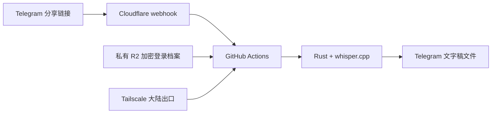

# 抖音转文字

把抖音视频的分享链接发给 Telegram 机器人，远端 GitHub Actions 获取视频并识别人声，机器人发回完整 TXT、SRT 字幕和带时间戳 JSON。只做抖音转文字。



项目没有 Python 脚本，不使用 yt-dlp。Rust 负责登录检查、抖音视频取流、下载、任务执行、档案加密和结果交付；Chromium 提供完整网页环境，FFmpeg 提取音轨，whisper.cpp 识别人声。Webhook 使用原生 JavaScript Worker，无前端构建。

## 第一次准备

1. 将 `.env.example` 复制成 `.env`，填写本应用私有 R2 的配置和 `PROFILE_ENCRYPTION_KEY`。密钥来自 `shared-video-transcriber keygen`，格式为 `AGE-SECRET-KEY-...`。真实值应放在 Infisical 共用 Project 的 `dev`、`/douyin-transcriber` 目录。
2. 本地安装 Docker，创建供容器用户使用的数据目录：`mkdir -p .runtime/docker`。Linux 上确保这个目录属于 UID 1000；macOS Docker Desktop 通常会自动映射权限。
3. 在远端 CI 构建镜像；本机运行已构建镜像，或在允许本地构建的环境执行 `docker compose build`。本仓库工作约定禁止为了验证改动在本地构建。
4. 运行 `docker compose run --rm --service-ports login`，打开 http://127.0.0.1:6080/vnc_lite.html 。点击连接，在工具的 Chromium 里亲自登录抖音，完成验证码。
5. Rust 检查抖音自己的登录接口。确认有效后正常关闭 Chromium，把完整 `browser.ini` 和 `user-data` 归档，使用 age 认证加密后上传私有 R2。上传成功再更新 `latest.json`，旧版本保留；本地明文目录随后清理。

完整用户目录包含 Cookie、Local Storage、IndexedDB 和缓存；只排除 `Singleton*` 进程锁。不会读取电脑日常浏览器的档案。容器使用非 root 用户并保留 Chromium 沙箱；Compose 的 `SYS_ADMIN` 和放宽 seccomp 是为沙箱所需的命名空间操作，仅给这个专用容器使用。浏览器调试接口仅监听容器内回环地址，登录网页只映射到宿主 `127.0.0.1`。

上传失败会保留这次已关闭的本地档案，可用 `docker compose run --rm login upload` 重试。登录状态未知、过期、取消或浏览器被强杀时，不上传新档案，也不覆盖旧版本。

## Telegram 和 CI 配置

Webhook 文件为 `worker/index.js`，入口 `POST /telegram`。设置 Telegram 的 `secret_token` 与 Worker 的 `TELEGRAM_WEBHOOK_SECRET` 一致，仅允许 `TELEGRAM_ALLOWED_USER_IDS` 中的用户在私聊触发任务。

| 位置 | 配置 |
|---|---|
| GitHub Organization Secrets | 复用 `INFISICAL_CLIENT_ID`、`INFISICAL_CLIENT_SECRET` |
| GitHub Repository Secret | `INFISICAL_SECRET_PATH=/douyin-transcriber` |
| GitHub Organization Variables | 共用 `INFISICAL_PROJECT_ID`、`INFISICAL_ENVIRONMENT=dev`、`INFISICAL_API_URL` |
| Infisical `/douyin-transcriber` | `.env.example` 中 CI 需要的 R2、age、Telegram、Tailscale 配置 |
| Infisical `/douyin-transcriber/webhook` | `TELEGRAM_BOT_TOKEN`、`TELEGRAM_WEBHOOK_SECRET`、`TELEGRAM_ALLOWED_USER_IDS`、`GITHUB_DISPATCH_TOKEN` |
| Worker 非敏感配置 | 仓库、`GITHUB_REF=main`、`GITHUB_WORKFLOW=transcribe.yml` |

Worker 密钥通过 Infisical 官方 Cloudflare Secret Sync 分发。`GITHUB_DISPATCH_TOKEN` 使用仅能对本仓库执行 Actions dispatch 的令牌。不要复用其他机器人的 webhook，不要把 R2 密钥或档案解密密钥同步到 Worker。

CI 使用 `.github/workflows/transcribe.yml`。每次从 R2 恢复档案，验证登录后读取抖音页面返回的视频地址，下载音视频并用 FFmpeg 提取 16 kHz 单声道音轨，调用 whisper.cpp 转文字。完整 TXT、SRT、JSON 分别发回 Telegram；视频和音轨仅是中间文件，不作为结果发送。会话和文字稿不上传 GitHub Artifacts，也不放进 Actions 缓存。

Tailscale 使用现有 OAuth 身份和出口 `armbian`；需确认出口在线、获得授权并设置 `TAILSCALE_EXPECTED_IP`。CI 检查实际公网 IP、中国大陆地区和抖音可达性，不符合就停止。模型和镜像在切换出口前准备。Telegram 和 R2 也必须能经这个出口访问；不会自动直连兜底。GitHub Actions 使用排队式 concurrency，避免同时改同一账号。

新 workflow 必须先合入默认分支，GitHub 才能接受 webhook 的 `workflow_dispatch`。PR review 期间只运行远端回归检查，不宣称生产机器人已经能完成真实抖音转录。

## 命令和结果

```text
shared-video-transcriber login
shared-video-transcriber upload
shared-video-transcriber restore
shared-video-transcriber model small
shared-video-transcriber transcribe '抖音分享文字或链接'
shared-video-transcriber transcribe --file /input/example.wav
shared-video-transcriber telegram-job
```

`telegram-job` 从 `VIDEO_INPUT`、`TELEGRAM_CHAT_ID` 读取本次请求。只接收允许名单内的私聊 ID。`WHISPER_MODEL` 指向 ggml 模型文件；默认 small，语言默认中文。本地音视频入口用于诊断和远端回归，原文件不会被删除。

每次结果保存在独立的 `VIDEO_DATA_DIR/jobs/<任务 ID>`：`transcript.txt`、`transcript.srt`、Whisper 原始 `transcript.json` 和统一结构的 `result.json`。没有人声时明确失败，不发送假文字。

抖音页面、登录接口和风控会变化。Cookie 存在不等于登录有效；跨设备恢复也不保证免验证码。过期后重新运行 Docker 登录。这里只转录可访问视频的人声，不识别画面文字，也不承诺付费内容、直播、图集和合集。

## 验证和实现来源

本地只做代码阅读、语法与差异检查；Rust 编译、测试、Docker 构建、真实 Chromium 与样例音频识别均在 GitHub Actions 运行。详细验收记录见 [tasklist.md](tasklist.md)，来源比较见 [设计说明](docs/DESIGN.md)。

MIT。语音识别基于 [ggml-org/whisper.cpp](https://github.com/ggml-org/whisper.cpp)；登录网页基于 [noVNC](https://github.com/novnc/noVNC)。
